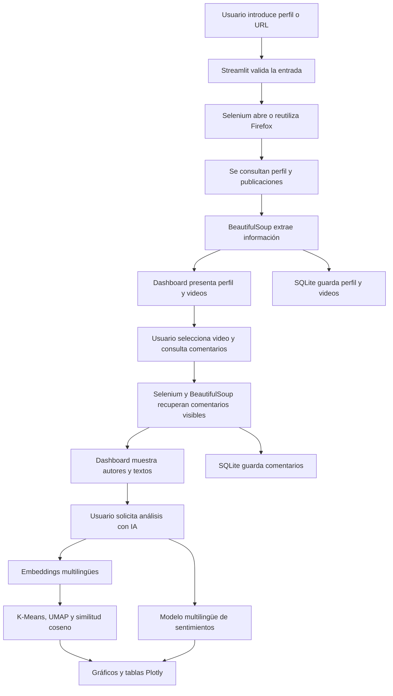

<div align="center">

# 🎵 TikTok Scraping & Analytics

### Extracción, almacenamiento y análisis semántico de perfiles, videos y comentarios públicos de TikTok

**Python · Streamlit · Selenium · BeautifulSoup · Firefox · SQLite · Embeddings · Machine Learning**

[](https://www.python.org/)
[](https://streamlit.io/)
[](https://www.selenium.dev/)
[](https://www.sqlite.org/)
[](https://huggingface.co/)
[](https://github.com/Jeff97ares/Tiktok-scraping)

**[Ver repositorio](https://github.com/Jeff97ares/Tiktok-scraping)**

</div>

---

## 📌 Descripción

**TikTok Scraping & Analytics** es una aplicación web desarrollada en Python para consultar información pública de perfiles de TikTok, explorar publicaciones, recuperar comentarios visibles y analizar su contenido mediante técnicas de procesamiento del lenguaje natural (PLN).

La solución combina **Selenium** y **Firefox Developer Edition** para la navegación automatizada, **BeautifulSoup** para interpretar el HTML, **Streamlit** para la interfaz, **SQLite** para el almacenamiento persistente y modelos de **machine learning** para representar y analizar comentarios.

El proyecto evolucionó desde un scraper con dashboard hasta una herramienta modular que integra **extracción, persistencia y análisis exploratorio de texto**.

> **Alcance actual:** trabaja con contenido público accesible; no descarga videos, no publica comentarios y no incluye todavía exportación de reportes ni una interfaz de recuperación del historial de perfiles almacenados.

## ✨ Funcionalidades implementadas

| Área | Funcionalidad | Descripción |
|---|---|---|
| 🔎 Extracción | Búsqueda de perfiles | Acepta `@usuario` o URL de perfil de TikTok. |
| 👤 Extracción | Datos del perfil | Obtiene nombre visible, seguidores y seguidos, cuando están disponibles. |
| 🎬 Extracción | Publicaciones | Recupera hasta el límite configurado de videos accesibles (inicialmente 10). |
| ▶️ Visualización | Reproductor integrado | Reproduce la publicación seleccionada mediante el reproductor de TikTok. |
| 💬 Extracción | Comentarios y autores | Intenta obtener hasta el límite configurado de comentarios visibles por video (inicialmente 10). |
| 🔍 Visualización | Búsqueda en comentarios | Permite filtrar comentarios recuperados por autor o contenido. |
| 🌐 Navegación | Sesión de Firefox reutilizable | Evita abrir un navegador nuevo en cada interacción cuando la sesión sigue disponible. |
| 🗄️ Persistencia | Base de datos SQLite | Almacena perfiles, videos y comentarios extraídos en `tiktok_data.db`. |
| ♻️ Persistencia | Actualización y control de duplicados | Actualiza perfiles/videos y evita duplicar comentarios idénticos del mismo autor en un video. |
| 📈 Persistencia | Estadísticas de almacenamiento | Muestra cuántos perfiles, videos y comentarios hay en la base. |
| 🧠 PLN | Embeddings | Convierte textos en representaciones vectoriales numéricas para comparar similitud semántica. |
| 🧩 PLN | Agrupación de comentarios | Utiliza K-Means para explorar grupos de comentarios semánticamente próximos. |
| 🌐 PLN | Mapa semántico | Reduce las representaciones a dos dimensiones con UMAP para visualizarlas. |
| 🔥 PLN | Matriz de similitud | Compara comentarios mediante similitud del coseno. |
| 💬 PLN | Sentimientos | Clasifica comentarios como positivos, neutros o negativos mediante un modelo multilingüe. |
| 📊 Analítica | Gráficos interactivos | Incluye mapa semántico, similitud, distribución de grupos, sentimientos y tabla de comentarios. |
| 🎯 Analítica | Filtro por publicación | Analiza comentarios de todos los videos cargados o de una publicación específica. |

> **Nota:** los límites son máximos, no cantidades garantizadas. El acceso a contenido y comentarios depende de TikTok, la visibilidad de las publicaciones, los tiempos de carga y posibles verificaciones de acceso.

## 🖥️ Interfaz del dashboard

La aplicación está organizada en secciones:

1. **Búsqueda y perfil:** ingreso del usuario o enlace, estadísticas y publicaciones encontradas.
2. **Publicación seleccionada:** descripción, enlace y reproductor integrado.
3. **Comentarios:** extracción, visualización y búsqueda por autor o texto.
4. **Estado de SQLite:** contadores de perfiles, videos y comentarios guardados.
5. **Análisis con IA y embeddings:** selección de comentarios, métricas, grupos exploratorios y cinco vistas de análisis.

<!-- Agrega aquí una captura real cuando esté disponible:

-->

## 🧰 Tecnologías y librerías

| Tecnología | Función |
|---|---|
| **Python** | Lenguaje principal del proyecto. |
| **Streamlit** | Dashboard web, controles, métricas y estado de sesión. |
| **Selenium WebDriver** | Automatización del navegador y contenido dinámico. |
| **Firefox Developer Edition / geckodriver** | Navegador y controlador utilizados por Selenium. |
| **BeautifulSoup (bs4)** | Análisis de HTML y extracción de información visible. |
| **`re`** | Expresiones regulares para reconocer o procesar patrones de texto. |
| **SQLite (`sqlite3`)** | Base de datos relacional local incluida en la biblioteca estándar de Python. |
| **Sentence Transformers** | Generación de embeddings de comentarios. |
| **Transformers (Hugging Face)** | Carga y ejecución del modelo de clasificación de sentimientos. |
| **scikit-learn** | K-Means y operaciones de análisis de similitud. |
| **UMAP** | Reducción de dimensionalidad para el mapa semántico. |
| **NumPy / pandas** | Cálculos y preparación de resultados tabulares. |
| **Plotly** | Gráficos interactivos del análisis. |
| **HTML / CSS** | Estilos y personalización visual. |
| **Git / GitHub** | Versionado y publicación del código fuente. |

### Modelos utilizados

- **Embeddings:** `sentence-transformers/paraphrase-multilingual-MiniLM-L12-v2`, utilizado para representar comentarios mediante vectores semánticos.
- **Sentimientos:** `cardiffnlp/twitter-xlm-roberta-base-sentiment`, utilizado para estimar las clases **negativo**, **neutro** y **positivo**.

Los modelos pueden descargarse automáticamente durante su primer uso; esto requiere conexión a Internet y puede tardar dependiendo del equipo. Posteriormente, los archivos descargados pueden reutilizarse desde la caché local.

## 🏗️ Arquitectura modular

```text
TikTok_Scraper/
├── main.py                # Aplicación Streamlit e integración de módulos
├── scraper.py             # Navegación Selenium y extracción con BeautifulSoup
├── components.py          # Componentes visuales reutilizables
├── styles.py              # Estilos CSS
├── database.py            # Creación, guardado y consultas SQLite
├── embeddings.py          # Generación de embeddings multilingües
├── analysis.py            # Agrupación, similitud y análisis de comentarios
├── sentiment.py           # Clasificación de sentimientos
├── charts.py              # Tablas y gráficos interactivos
├── requirements.txt       # Dependencias de Python
├── README.md              # Documentación
├── .gitignore             # Exclusiones de Git
├── tiktok_data.db         # Base de datos local (generada; no subir a GitHub)
└── venv/                  # Entorno virtual local (no subir a GitHub)
```

**Separación de responsabilidades:** `scraper.py` obtiene los datos; `database.py` los conserva; `embeddings.py`, `analysis.py` y `sentiment.py` los procesan; `charts.py` los representa; y `main.py` coordina todo desde Streamlit.

## 🔄 Flujo de funcionamiento



El análisis con IA **se ejecuta bajo demanda**. Los modelos no necesitan cargarse al abrir inicialmente el dashboard, lo que ayuda a reducir el tiempo de inicio.

## 🗄️ Almacenamiento con SQLite

La aplicación crea o utiliza el archivo **`tiktok_data.db`** en la carpeta del proyecto. Los datos permanecen disponibles aunque se cierre Streamlit o se reinicie el equipo, siempre que el archivo se conserve.

| Tabla | Datos principales | Comportamiento |
|---|---|---|
| `perfiles` | Usuario, nombre, seguidores, seguidos y fecha de actualización | Un registro por nombre de usuario; consultas posteriores actualizan la información. |
| `videos` | ID del video, usuario, URL, descripción y fecha | Un registro por identificador; se actualizan sus datos. |
| `comentarios` | Video, autor, texto y fecha de extracción | Se evitan duplicados con la misma combinación de video, autor y texto. |

**Importante:** en la versión actual, el dashboard muestra estadísticas de la base, pero **todavía no incluye un navegador del historial** para elegir perfiles anteriores y recuperar sus comentarios sin repetir la extracción. Asimismo, el análisis con IA trabaja con los comentarios disponibles en la sesión de Streamlit.

### Consultar perfiles guardados desde la terminal

Desde la carpeta del proyecto, en PowerShell:

```powershell
python -c "import sqlite3; c=sqlite3.connect('tiktok_data.db'); print(*c.execute('SELECT username, nombre, seguidores, seguidos FROM perfiles').fetchall(), sep='\n'); c.close()"
```

Para consultar la cantidad de registros:

```powershell
python -c "from database import obtener_estadisticas; print(obtener_estadisticas())"
```

También puedes abrir `tiktok_data.db` con una extensión de Visual Studio Code compatible con SQLite.

> **Privacidad y repositorio:** no publiques `tiktok_data.db`, copias de la base de datos, sesiones del navegador ni información sensible. Asegúrate de que `.gitignore` contenga `*.db`, `venv/`, `__pycache__/` y `*.pyc`.

## 🧠 Análisis de comentarios con IA

### 1. Embeddings semánticos

Los comentarios se transforman en **vectores numéricos** que representan aspectos de su significado. Esto permite calcular semejanzas entre textos aunque no compartan exactamente las mismas palabras.

### 2. Agrupación de comentarios

**K-Means** organiza la muestra en grupos exploratorios a partir de los embeddings. En la configuración actual se trabajan tres grupos cuando la muestra permite realizar el análisis. El dashboard presenta un comentario representativo y los textos asociados a cada grupo.

> Los grupos **no son categorías temáticas validadas**. Sus números son identificadores; deben interpretarse leyendo los comentarios de cada conjunto.

### 3. Visualización semántica

**UMAP** proyecta los embeddings en dos dimensiones para crear un mapa interactivo. La proximidad visual es aproximada y no debe interpretarse como una medida exacta de igualdad de significado.

### 4. Similitud entre comentarios

La **similitud del coseno** permite comparar los vectores y representar los resultados mediante una matriz de calor. Los valores más altos indican mayor similitud según el modelo utilizado.

### 5. Clasificación de sentimientos

Un modelo multilingüe estima para cada comentario una de tres clases:

- **Positivo**
- **Neutro**
- **Negativo**

El dashboard muestra conteos, porcentajes y puntuaciones del modelo. **La puntuación de confianza no equivale a precisión demostrada**: el sistema puede equivocarse con sarcasmo, expresiones locales, idiomas distintos, textos breves y contenido fuera del contexto de entrenamiento.

### 6. Visualizaciones disponibles

| Vista | Propósito |
|---|---|
| 🌐 Mapa semántico | Explorar proximidad entre comentarios en dos dimensiones. |
| 🔥 Similitud | Observar la matriz de similitud entre textos. |
| 📊 Grupos | Comparar la distribución de comentarios por grupo. |
| 💬 Sentimientos | Visualizar las clases de sentimiento estimadas. |
| 📋 Comentarios | Consultar los registros analizados, sus grupos y resultados. |

**Requisito de uso:** extraer al menos **cinco comentarios** en la selección actual antes de ejecutar el análisis.

## ⚙️ Instalación y ejecución

### 1. Requisitos

- Python compatible con las versiones indicadas en `requirements.txt` (el proyecto se ha trabajado con Python 3.9).
- Git, si deseas clonar el repositorio.
- Firefox Developer Edition o una instalación de Firefox compatible con Selenium.
- Conexión a Internet para acceder a TikTok y descargar modelos en su primer uso.
- Recursos suficientes de CPU, memoria y almacenamiento para ejecutar los modelos localmente.

> **Firefox en Windows:** revisa en `scraper.py` la configuración de la ruta del ejecutable (por ejemplo, `DEVELOPER_EXE`) si el navegador está instalado en una ubicación distinta.

### 2. Clonar el repositorio

```bash
git clone https://github.com/Jeff97ares/Tiktok-scraping.git
cd Tiktok-scraping
```

### 3. Crear y activar un entorno virtual

**Windows (PowerShell):**

```powershell
python -m venv venv
.\venv\Scripts\Activate.ps1
```

**Linux/macOS:**

```bash
python3 -m venv venv
source venv/bin/activate
```

### 4. Instalar dependencias

```bash
python -m pip install --upgrade pip
python -m pip install -r requirements.txt
```

Comprueba que `requirements.txt` incluya las dependencias efectivamente utilizadas por los módulos de scraping, embeddings, clasificación y visualización. Algunas combinaciones de versiones de Python, PyTorch y Transformers pueden requerir ajustes de compatibilidad.

### 5. Ejecutar el dashboard

```bash
python -m streamlit run main.py
```

Abre la dirección mostrada en la terminal, habitualmente **http://localhost:8501**.

## 🚀 Guía de uso

1. Introduce `@usuario` o la URL de un perfil público de TikTok.
2. Pulsa **Consultar perfil** y espera a que se obtengan los datos y videos accesibles. El perfil y sus publicaciones se almacenan en SQLite.
3. Selecciona una publicación para revisar su descripción y reproducir el video.
4. Pulsa **Consultar comentarios** para recuperar autores y textos visibles. Los comentarios obtenidos se guardan en SQLite.
5. Consulta **Estado de la base de datos SQLite** para comprobar el número de registros almacenados.
6. Abre **Análisis con IA y embeddings**, elige todos los videos cargados o uno específico y asegúrate de contar con al menos cinco comentarios.
7. Pulsa **Analizar temas y sentimientos**. En el primer análisis puede ser necesario descargar modelos, por lo que tardará más.
8. Examina las métricas, los grupos y las cinco visualizaciones; interpreta los resultados teniendo en cuenta las limitaciones de la muestra y del modelo.

## ⚠️ Limitaciones y uso responsable

- Solo se intenta consultar **información pública accesible**; no se obtiene acceso a cuentas privadas.
- TikTok puede mostrar CAPTCHA, limitar consultas, cambiar el HTML o impedir la carga de determinadas publicaciones o comentarios.
- Los selectores y tiempos de espera pueden requerir mantenimiento cuando cambia la interfaz de TikTok.
- Los comentarios analizados son una **muestra parcial** y no representan necesariamente todas las opiniones de un perfil o video.
- La agrupación y la clasificación de sentimientos son resultados automáticos **exploratorios**, no juicios sobre las personas ni evaluaciones psicológicas.
- La calidad de las predicciones puede variar según idioma, jerga, sarcasmo y contexto.
- La base de datos local almacena información de usuarios y comentarios públicos; evita compartirla innecesariamente y respeta la privacidad, los términos de la plataforma y la normativa aplicable.
- La herramienta no descarga archivos de video ni publica contenido en TikTok.

## 🛠️ Mejoras futuras

- [ ] Incorporar una sección **Historial de perfiles consultados** dentro de Streamlit.
- [ ] Recuperar videos y comentarios históricos desde SQLite para analizarlos sin repetir el scraping.
- [ ] Detectar el idioma de los comentarios y evaluar estrategias de análisis multilingüe.
- [ ] Mejorar la interpretación y el etiquetado de los grupos semánticos.
- [ ] Permitir comparar publicaciones y analizar muestras más amplias.
- [ ] Exportar resultados a CSV y generar informes PDF.
- [ ] Añadir pruebas automatizadas y mejorar el manejo de errores.
- [ ] Incorporar capturas reales del dashboard al README.
- [ ] Revisar y simplificar `requirements.txt` y documentar versiones compatibles.

## 📚 Aprendizajes del proyecto

Este proyecto integra **programación modular**, automatización de navegadores, interpretación de HTML, extracción de contenido dinámico, desarrollo de interfaces con Streamlit, persistencia de datos mediante SQLite y técnicas de **procesamiento del lenguaje natural**. También permite practicar control de versiones con Git/GitHub y comprender la diferencia entre extraer datos, almacenarlos, representarlos como embeddings y analizarlos con modelos de aprendizaje automático.

---

<div align="center">

**Proyecto desarrollado con Python, Selenium, BeautifulSoup, Streamlit, SQLite y modelos de PLN.**

[⬆ Volver al inicio](#-tiktok-scraping--analytics)

</div>
